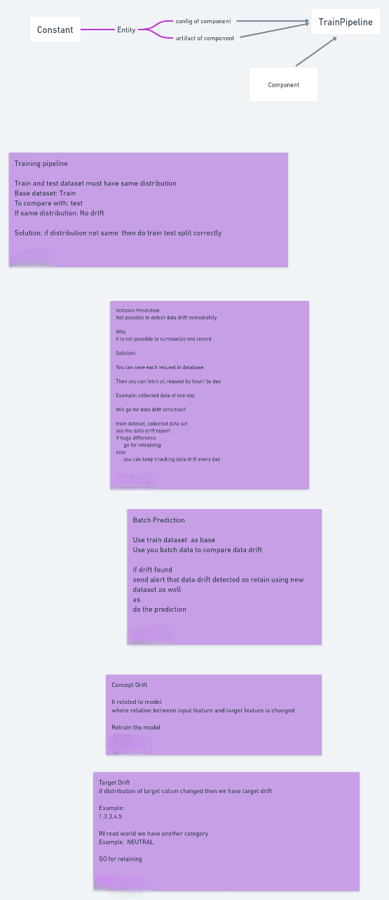
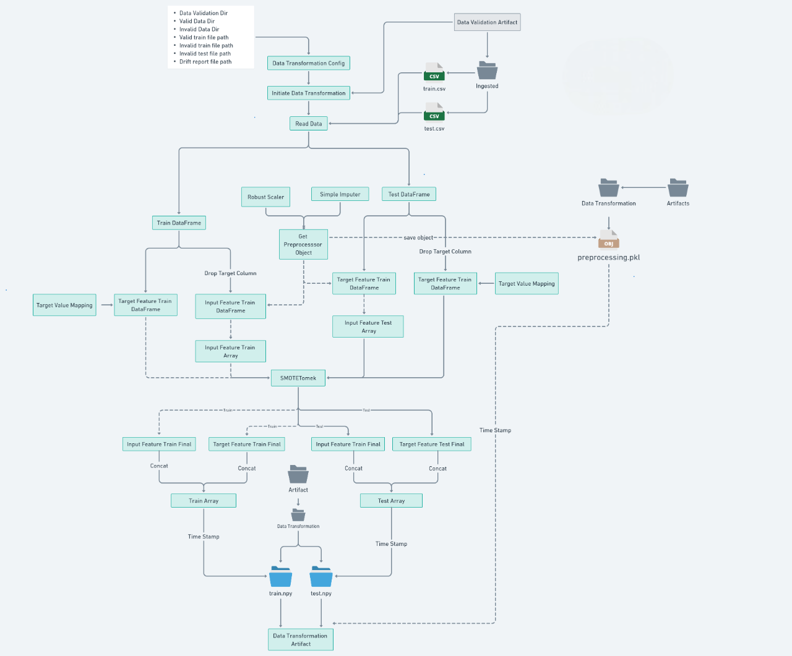

<div align="center">

# ⚙️ Scania APS Sensor Fault Prediction (`SENSOR`)
### End-to-End Modular MLOps Pipeline for Heavy-Vehicle Air Pressure System Diagnostics

[](https://www.python.org/)
[](https://scikit-learn.org/)
[](https://www.mongodb.com/)
[](https://aws.amazon.com/s3/)
[](https://github.com/features/actions)
[](https://opensource.org/licenses/MIT)

*A production-grade Machine Learning & MLOps system engineered to detect Air Pressure System (APS) sensor faults in Scania heavy-duty trucks—integrating MongoDB data ingestion, schema validation, automated preprocessing, cost-sensitive classification, and AWS S3 model registry.*

<p align="center">
  <a href="#-problem-statement">Problem Statement</a> •
  <a href="#-system-architecture--flowcharts">Architecture</a> •
  <a href="#-pipeline-components">Pipeline Stages</a> •
  <a href="#-project-structure">Project Structure</a> •
  <a href="#-getting-started">Quick Start</a>
</p>

</div>

---

## 📌 Problem Statement

The **Air Pressure System (APS)** generates pressurized air that powers critical heavy-vehicle operations, including braking and gear changes. In fleet maintenance, distinguishing whether an imminent failure originates in the APS (`pos`) or an unrelated subsystem (`neg`) directly impacts operational cost and safety:

- **False Positives (`Cost_1 = $10`):** Trigger an unnecessary preventative inspection at a workshop.
- **False Negatives (`Cost_2 = $500`):** Miss an actual APS defect, resulting in an unexpected roadside breakdown and expensive emergency repairs.

This project packages the entire lifecycle—from **MongoDB telemetry extraction** to **AWS S3 model deployment**—into an installable, modular Python package (`SENSOR`) achieving **>96% classification accuracy** while minimizing total asymmetric maintenance costs.

---

## 🏗️ System Architecture & Flowcharts

### Overall Process & Streaming Architecture
<p align="center">
  
</p>

<details>
<summary><b>📡 View Streaming Data Producer & Consumer Architecture (Draw.io Diagrams)</b></summary>
<br>
<p align="center">
  <b>Data Producer Workflow</b><br>
  
</p>
<p align="center">
  <b>Data Consumer Workflow</b><br>
  
</p>
</details>

### End-to-End Training & Prediction Pipelines
<p align="center">
  
</p>
<p align="center">
  
</p>

---

## 🧩 Pipeline Components

The training pipeline (`SENSOR/pipeline/training_pipeline.py`) executes six sequential, decoupled components tracked via typed `config_entity.py` and `artifact_entity.py` dataclasses:

### 1. Data Ingestion (`SENSOR/components/data_ingestion.py`)
- Connects to **MongoDB** via `SENSOR/data_access/sensor_data.py` to pull raw Scania sensor documents.
- Converts collection records into a standardized Pandas DataFrame, replaces `'na'` literals with `np.nan`, stores a snapshot in the feature store, and performs a stratified train-test split.

<p align="center">
  
</p>

### 2. Data Validation (`SENSOR/components/data_validation.py`)
- Enforces structural integrity against `config/schema.yaml` (verifying total column counts, numerical data types, and dropped/missing attributes).
- Performs statistical **Data Drift Detection** (Kolmogorov-Smirnov test via `scipy.stats`) between training and testing distributions, generating a validation drift report.

<p align="center">
  
</p>

### 3. Data Transformation (`SENSOR/components/data_transformation.py`)
- Builds a reproducible preprocessing pipeline (`RobustScaler` + `SimpleImputer`) to handle extreme sensor outliers and high missingness.
- Balances the skewed target distribution (`pos` vs. `neg`) using **SMOTEENN** (`imbalanced-learn`) and encodes labels via `TargetValueMapping`.
- Serializes both the transformation pipeline object (`preprocessing.pkl`) and transformed `.npy` arrays.

<p align="center">
  
</p>

### 4. Model Trainer (`SENSOR/components/model_trainer.py`)
- Trains and tunes classifiers (`XGBoost`, `CatBoost`, `RandomForest`, `GradientBoosting`) on the transformed arrays.
- Computes training and testing performance via `SENSOR/ml/metric/classification_metric.py` (F1-Score, Precision, Recall) and checks against the minimum accuracy threshold and overfitting tolerance.
- Bundles the fitted preprocessor and classifier into a unified `SensorModel` estimator (`SENSOR/ml/metric/model/estimator.py`) for seamless inference.

<p align="center">
  
</p>

### 5. Model Evaluation (`SENSOR/components/model_evaluation.py`)
- Benchmarks the newly trained model against the currently deployed production model (if one exists in the model registry).
- Approves the candidate model only if its F1 improvement exceeds the configured `MODEL_EVALUATION_CHANGED_THRESHOLD_SCORE`.

<p align="center">
  
</p>

### 6. Model Pusher (`SENSOR/components/model_pusher.py`)
- Promotes the approved `SensorModel` artifact to the local `saved_models/` registry and syncs artifacts/models directly to **AWS S3** via `SENSOR/cloud_storage/s3_syncer.py`.

<p align="center">
  
</p>

---

## 🛠️ Tech Stack

| Layer | Technologies Used |
| :--- | :--- |
| **Core Language** | Python 3.10+ |
| **Machine Learning** | `scikit-learn`, `xgboost`, `catboost`, `imbalanced-learn`, `scipy` |
| **Data Processing & Visualization** | `pandas`, `numpy`, `matplotlib`, `seaborn`, `plotly` |
| **Database & Cloud Storage** | `pymongo` (MongoDB Atlas), `boto3` / AWS CLI (Amazon S3) |
| **Configuration & Serialization** | `PyYAML` (`schema.yaml`), `dill` / `joblib`, `python-dotenv` |
| **CI/CD & DevOps** | GitHub Actions (`github/workflow/main.yaml`), Docker |

---

## 📂 Project Structure

```text
APS---Sensor/
├── config/
│   └── schema.yaml                         # Dataset column definitions & validation schema
├── docs/
│   ├── producer.drawio (2).svg             # Telemetry producer architecture diagram
│   └── consumer.drawio (2).svg             # Telemetry consumer architecture diagram
├── Flowcharts/                             # Component-level MLOps architecture diagrams
│   ├── 0_Sensor Training Pipeline.png
│   ├── Process.png
│   ├── Sensor_Data Ingestion Component.png
│   ├── Sensor_Data Validation Component -Photoroom.png
│   ├── Sensor_Data_Transformation_Component-Photoroom.png
│   ├── Sensor_Model Trainer Component.png
│   ├── Sensor Model Evaluation Component.png
│   ├── Sensor Model Pusher Component.png
│   └── Sensor Prediction Pipeline.png
├── github/workflow/
│   └── main.yaml                           # CI/CD deployment workflow
├── Notebook/
│   └── Scania_APS_failure_prediction.ipynb # EDA, feature engineering & model experiments
├── SENSOR/                                 # Core installable MLOps Python package
│   ├── __init__.py
│   ├── config.py                           # Environment & client configuration
│   ├── exception.py                        # Custom traceback exception handler
│   ├── logger.py                           # Timestamped file logging utility
│   ├── utils2.py                           # Helper utilities
│   ├── cloud_storage/
│   │   ├── s3_storage.py                   # Boto3 S3 operations
│   │   └── s3_syncer.py                    # AWS S3 bucket directory synchronization
│   ├── components/
│   │   ├── data_ingestion.py               # Stage 1: MongoDB extraction & splitting
│   │   ├── data_validation.py              # Stage 2: Schema & KS-drift validation
│   │   ├── data_transformation.py          # Stage 3: Imputation, scaling & SMOTEENN
│   │   ├── model_trainer.py                # Stage 4: Classifier training & bundling
│   │   ├── model_evaluation.py             # Stage 5: Champion vs. Challenger comparison
│   │   └── model_pusher.py                 # Stage 6: Model registry promotion
│   ├── configuration/
│   │   └── mongodb_db_connection.py        # MongoDB Atlas TLS client singleton
│   ├── constant/
│   │   ├── application.py                  # Host/port constants
│   │   ├── database.py                     # MongoDB database & collection names
│   │   ├── env_variable.py                 # Environment variable keys
│   │   ├── s3_bucket.py                    # S3 bucket names for artifacts & models
│   │   └── training_pipeline/__init__.py   # Pipeline thresholds, file names & directories
│   ├── data_access/
│   │   └── sensor_data.py                  # MongoDB collection-to-DataFrame exporter
│   ├── entity/
│   │   ├── config_entity.py                # Component configuration dataclasses
│   │   └── artifact_entity.py              # Component output artifact dataclasses
│   ├── ml/metric/
│   │   ├── classification_metric.py        # F1, Precision, Recall & cost calculators
│   │   └── model/estimator.py              # TargetValueMapping & SensorModel wrapper
│   ├── pipeline/
│   │   └── training_pipeline.py            # End-to-end training pipeline orchestrator
│   └── utils/
│       └── main_utils.py                   # YAML, NumPy & Dill serialization helpers
├── logs/                                   # Execution logs organized by timestamp
├── setup.py                                # Package installation script
├── requirements.txt                        # Python dependencies
└── README.md                               # Project documentation
```

---

## 🚀 Getting Started

### 1. Clone the Repository
```bash
git clone [https://github.com/AbhyanandSharma2005/APS---Sensor.git](https://github.com/AbhyanandSharma2005/APS---Sensor.git)
cd APS---Sensor
```

### 2. Create & Activate Virtual Environment
```bash
# Windows (PowerShell)
python -m venv .venv
.\.venv\Scripts\Activate.ps1

# Linux / macOS
python3 -m venv .venv
source .venv/bin/activate
```

### 3. Configure Environment Variables
Create a `.env` file in the root directory (or export in your shell) with your MongoDB and AWS credentials:
```env
MONGO_DB_URL="mongodb+srv://<username>:<password>@cluster0.mongodb.net/?retryWrites=true&w=majority"
AWS_ACCESS_KEY_ID="<your-aws-access-key>"
AWS_SECRET_ACCESS_KEY="<your-aws-secret-key>"
AWS_DEFAULT_REGION="us-east-1"
```

### 4. Install Dependencies & Editable `SENSOR` Package
```bash
pip install -r requirements.txt
pip install -e .
```

### 5. Run the Training Pipeline
Execute the main entry script to trigger data ingestion, validation, transformation, model training, evaluation, and S3 syncing:
```bash
python main.py
```
*(Or explore the full experimental workflow interactively in `Notebook/Scania_APS_failure_prediction.ipynb`.)*

---

## 📝 Logging & Exception Handling

- **Structured Execution Logs (`SENSOR/logger.py`):** Every pipeline run automatically generates a timestamped `.log` file inside the `logs/` directory tracking stage transitions, drift test outcomes, and evaluation metrics.
- **Custom Exception Tracebacks (`SENSOR/exception.py`):** Captures the exact Python script name, line number, and error message across all pipeline stages for rapid debugging.

---

## 👤 Author

**Abhyanand Sharma**
- **GitHub:** [@AbhyanandSharma2005](https://github.com/AbhyanandSharma2005)
- **Repository:** [APS---Sensor](https://github.com/AbhyanandSharma2005/APS---Sensor)

---

## 📄 License

This project is licensed under the **MIT License** — see the [LICENSE](LICENSE) file for details.